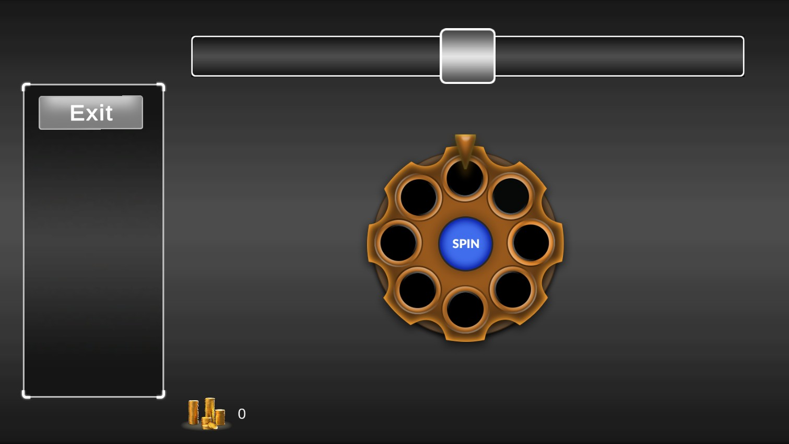
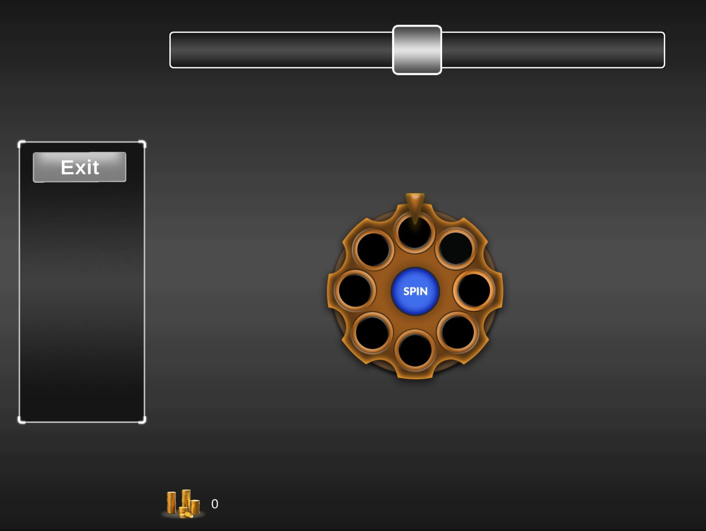
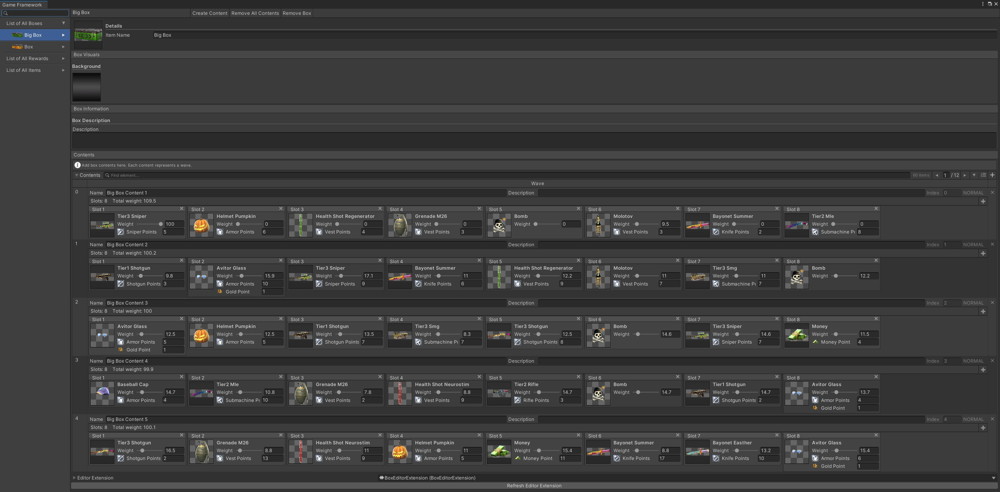
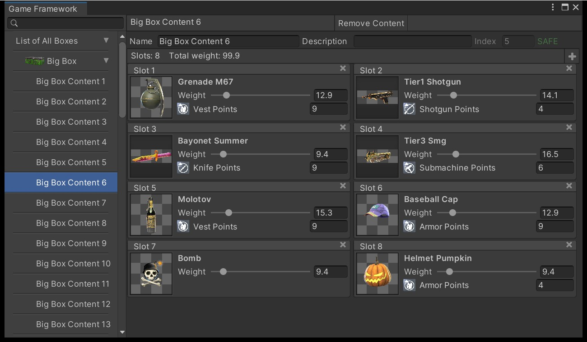
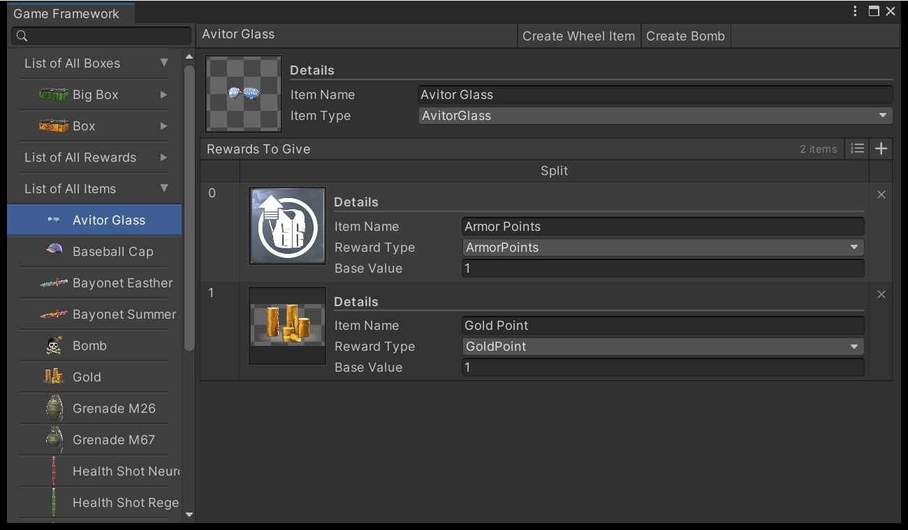
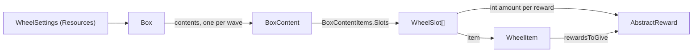
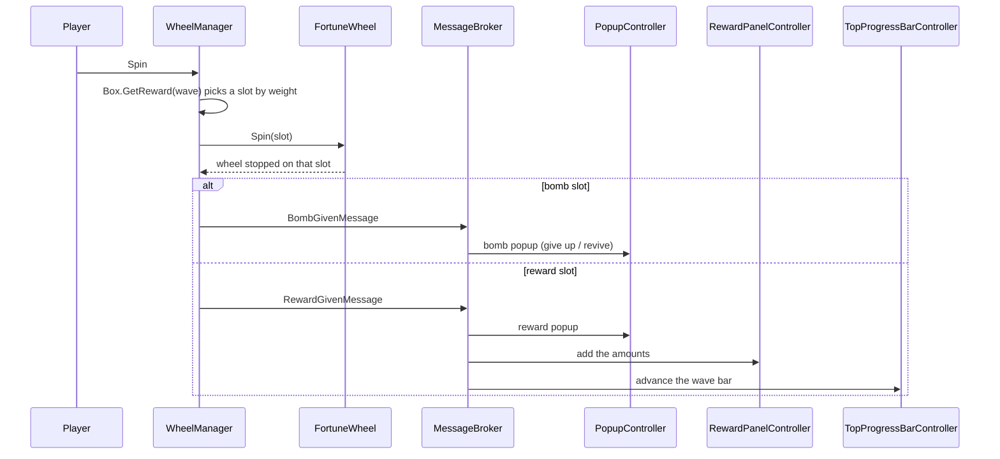

# Wheel of Fortune — Vertigo Games Case Study

A risk-and-reward spin wheel made in Unity, plus an Odin-based editor framework that lets a designer build boxes, waves, items and rewards without writing code.


<p align="center">
  
</p>

<p align="center">
  <a href="Video/Game.mp4"><b>Gameplay video</b></a> &nbsp;·&nbsp;
  <a href="APK/Release.apk"><b>Android APK</b></a> &nbsp;·&nbsp;
  <a href="#editor-framework"><b>Editor framework</b></a> &nbsp;·&nbsp;
  <a href="#architecture"><b>Architecture</b></a>
</p>

## Gameplay

- Every spin picks one slot of the current wave by weight. The wheel stops on that slot and its reward moves to the panel on the left.
- Normal waves can hold a bomb. Hitting it opens a popup: **Give Up** ends the run and drops the collected rewards, **Revive** continues to the next wave.
- Safe waves (index divisible by 5) and super waves (index divisible by 30) use their own wheel and indicator art, and the content randomizer never places a bomb in them.
- **Exit** asks for confirmation, saves the collected gold to `PlayerPrefs` and starts a new run.
- The bar at the top scrolls to the next wave number and is tinted by the wave type.

| 16:9 | 4:3 |
| :---: | :---: |
|  |  |

## Getting started

1. Open the project with **Unity 2021.3.45f1**.
2. Open `Assets/Game/Scenes/Game.unity` and press Play.
3. Open the authoring window from **Tools → Game Framework**.

The wheel reads its data from `Assets/Game/Resources/WheelSettings.asset`, which points to the **Big Box** (60 waves).

## Editor framework

**Tools → Game Framework** is an Odin menu window with three lists: boxes, rewards and items.

| Area | What you can do |
| --- | --- |
| Boxes | Create a box, add any number of waves (`BoxContent`), remove waves or whole boxes. **Randomize All Contents** fills every wave from the item list with per-wave-type value ranges; **Equalize All Weights** spreads the probability evenly. |
| Waves | Each wave is a list of wheel slots. Add, remove or drag slots to change how many the wheel shows. Every slot has an item, a weight and a whole-number amount for each of the item's rewards. |
| Items | Create wheel items or a bomb. The `ItemType` enum is regenerated automatically. |
| Rewards | Create rewards through a type picker. The `RewardType` enum is regenerated automatically. |
| Validation | An Odin validator keeps each asset's file name equal to its item name and offers a one-click fix. |

| Box | Wave | Item |
| :---: | :---: | :---: |
|  |  |  |

> The screenshots were taken before waves became a variable-length slot list, so they still show the fixed 8-slot grid.

## Architecture

### Assemblies

| Assembly | Contents |
| --- | --- |
| `Game.Collectable` | `WheelItem`, `BombItem`, rewards, `WheelSlot` |
| `Game.Boxes` | `Box`, `BoxContent` (one wave), `BoxContentItems` (the slot array), content randomizer |
| `Game.UI` | Wheel, popups, wave bar, reward panel, `GameMessages` |
| `Game.Utilities` | Generic object pool and constants |
| `Game.Editor` | Game Framework window, asset creators, `WheelSlotDrawer`, enum generator |
| `Attributes`, `Validators` | `[NameCheck]` attribute and its Odin validator |

### Data



### One spin



### Events

UI systems talk through the UniRx `MessageBroker`, which routes messages by type. Each event is its own type in [`GameMessages.cs`](Assets/Game/Scripts/Runtime/UI/GameMessages.cs), so a wrong event name fails to compile instead of being silently ignored:

```csharp
MessageBroker.Default.Publish(new GameOverMessage());

MessageBroker.Default.Receive<GameOverMessage>()
    .Subscribe(_ => ResetGame())
    .AddTo(disposables);
```

| Message | Published by | Received by |
| --- | --- | --- |
| `RewardGivenMessage` | `WheelManager` | `PopupController`, `RewardPanelController`, `TopProgressBarController` |
| `BombGivenMessage` | `WheelManager` | `PopupController` |
| `WaveTypeChangedMessage` | `WheelManager` | `TopProgressBarController` |
| `ProgressFirstStopMessage` | `DOTweenProgressBar` | `TopProgressBarController` |
| `RewardPopupClosedMessage` | `RewardPopupView` | `WheelManager` |
| `BombPopupClosedMessage` | `BombPopupView` | `WheelManager` |
| `ExitButtonClickedMessage` | `RewardPanelController` | `PopupController` |
| `ExitConfirmedMessage` | `PopupController` | `RewardPanelController` |
| `GameOverMessage` | `PopupController` (give up), `RewardPanelController` (exit) | `WheelManager`, `TopProgressBarController`, `RewardPanelController`, `MoneyShowController` |
| `PlayerRevivedMessage` | `PopupController` | no subscriber yet |

**Server-ready enums.** Enums leave the client by name, never by number: send `WaveType.Super.ToString()` (`"Super"`) and read it back with `Enum.TryParse`. Unity's `JsonUtility` writes enums as integers, so a request or response DTO should hold the name in a `string` field. The generated `ItemType` and `RewardType` enums only ever get new entries at the end, so their names are stable IDs.

### Project layout

```
Assets/Game
├── Scripts
│   ├── Runtime
│   │   ├── Boxes         Box, BoxContent (wave), BoxContentItems (slot array)
│   │   ├── Collectable   wheel items, bomb, rewards, WheelSlot
│   │   ├── UI            wheel, popups, wave bar, reward panel, GameMessages
│   │   └── Utilities     object pool, constants
│   ├── Editor            Game Framework window, creators, drawers, enum generator
│   ├── Attributes        NameCheck attribute
│   └── Validators        Odin name validator
├── ScriptableObjects     boxes, items, rewards
├── Resources             WheelSettings, ProgressBarSettings, DOTweenSettings
└── Art, Prefabs, Scenes
```

## Changes after the case submission

The case was submitted on **16 January 2025** (the `Final APK` commit). The APK and the gameplay video are from that build. Later work:

| Date | Change |
| --- | --- |
| 2025-01-20 | Wheel refactor: pooled `WheelObject` slot views |
| 2025-01-28 – 30 | Editor framework refactor, new icons, `WheelSettings` cleanup |
| 2026-11-03 | Typed events, integer reward amounts, variable slot count (details below) |

**2026-11-03 update**

- **Type-safe events.** String constants with `Receive<string>().Where(msg => msg == ...)` were replaced by one message type per event.
- **Simpler reward amounts.** `WheelSlot` used to keep values as `object` in a dictionary, serialize them as JSON strings and convert them with a generic `GetValue<T>`. It now stores a list of rewards with an `int` amount. The old strings were culture-formatted (`"17,57432"`), so the same asset could parse to a different number on a device with another locale.
- **Variable slot count.** `BoxContentItems` holds a `WheelSlot[]` instead of `slot1` … `slot8`, and the wheel lays itself out for any count. Spins target the slot index, so two slots with the same item can no longer stop on the wrong one.
- **Data migration.** All 70 existing waves (560 slots) were converted. Amounts were rounded to the whole numbers the wheel already displayed.
