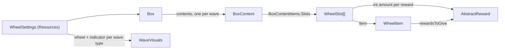
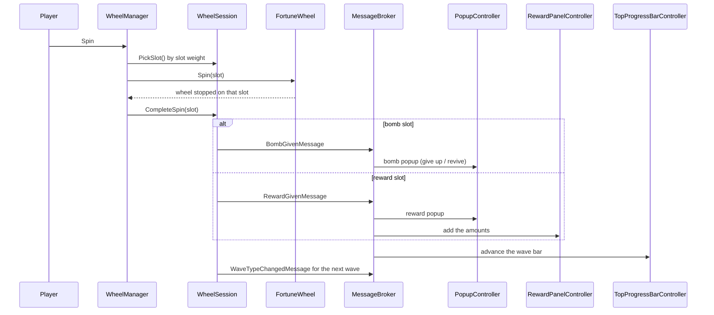

# Wheel of Fortune — Vertigo Games Case Study

A risk-and-reward spin wheel made in Unity, plus an Odin-based editor framework that lets a designer build boxes, waves, items and rewards without writing code.


<p align="center">
  
</p>

<p align="center">
  <a href="Video/Game.mp4"><b>Gameplay video</b></a> &nbsp;·&nbsp;
  <a href="APK/Release.apk"><b>Android APK</b></a> &nbsp;·&nbsp;
  <a href="#editor-framework"><b>Editor framework</b></a> &nbsp;·&nbsp;
  <a href="#architecture"><b>Architecture</b></a>
</p>

## Gameplay

- Every spin picks one slot of the current wave by weight. The wheel stops on that slot and its reward moves to the panel on the left.
- Normal waves can hold a bomb. Hitting it opens a popup: **Give Up** ends the run and drops the collected rewards, **Revive** continues to the next wave.
- Safe waves (index divisible by 5) and super waves (index divisible by 30) use their own wheel and indicator art, and the content randomizer never places a bomb in them.
- **Exit** asks for confirmation, saves the collected gold to `PlayerPrefs` and starts a new run.
- The bar at the top scrolls to the next wave number and is tinted by the wave type.

| 16:9 | 4:3 |
| :---: | :---: |
|  |  |

## Getting started

1. Open the project with **Unity 2021.3.45f1**.
2. Open `Assets/Game/Scenes/Game.unity` and press Play.
3. Open the authoring window from **Tools → Game Framework**.

The wheel reads its settings from `Assets/Game/Resources/WheelSettings.asset`: the box it plays (**Big Box**, 60 waves), spin and slot layout, and the wheel and indicator art for each wave type.

## Editor framework

**Tools → Game Framework** is an Odin menu window with three lists: boxes, rewards and items.

| Area | What you can do |
| --- | --- |
| Boxes | Create a box, add any number of waves (`BoxContent`), remove waves or whole boxes. **Randomize All Contents** fills every wave from the item list with per-wave-type value ranges; **Equalize All Weights** spreads the probability evenly. |
| Waves | Each wave shows its name, index and type (normal, safe, super) above a grid of slot cards. Add or remove cards to change how many slots the wheel shows; each card has an item, a weight and a whole-number amount for each of the item's rewards. |
| Items | Create wheel items or a bomb. The `ItemType` enum is regenerated automatically, and the item stores its type as the enum name (picked from a dropdown). |
| Rewards | Create rewards through a type picker. The `RewardType` enum is regenerated automatically, and the reward stores its type as the enum name. |
| Validation | An Odin validator keeps each asset's file name equal to its item name and offers a one-click fix. |
| Wheel art | Wheel and indicator sprites for normal, safe and super waves are set once in `WheelSettings`, so every box uses the same art. |

| Box | Wave | Item |
| :---: | :---: | :---: |
|  |  |  |

## Architecture

### Assemblies

| Assembly | Contents |
| --- | --- |
| `Game.Collectable` | `WheelItem`, `BombItem`, rewards, `WheelSlot` |
| `Game.Boxes` | `Box`, `BoxContent` (one wave and its `WaveType` rule), `BoxContentItems` (the slot array), content randomizer |
| `Game.UI` | `WheelSession` (the run's rules, plain C#), `WheelManager` (Unity wiring), popups, wave bar, reward panel, `GameMessages` |
| `Game.Utilities` | Generic object pool, `GoldWallet` (saved gold), constants |
| `Game.Editor` | Game Framework window, asset creators, `WheelSlotDrawer`, enum generator |
| `Attributes`, `Validators` | `[NameCheck]` attribute and its Odin validator |

### Data



### One spin



### Events

UI systems talk through the UniRx `MessageBroker`, which routes messages by type. Each event is its own type in [`GameMessages.cs`](Assets/Game/Scripts/Runtime/UI/GameMessages.cs), so a wrong event name fails to compile instead of being silently ignored:

```csharp
MessageBroker.Default.Publish(new GameOverMessage());

MessageBroker.Default.Receive<GameOverMessage>()
    .Subscribe(_ => ResetGame())
    .AddTo(disposables);
```

| Message | Published by | Received by |
| --- | --- | --- |
| `RewardGivenMessage` | `WheelSession` | `PopupController`, `RewardPanelController`, `TopProgressBarController` |
| `BombGivenMessage` | `WheelSession` | `PopupController`, `TopProgressBarController` |
| `WaveTypeChangedMessage` | `WheelSession` | `TopProgressBarController` |
| `ProgressFirstStopMessage` | `DOTweenProgressBar` | `TopProgressBarController` |
| `RewardPopupClosedMessage` | `RewardPopupView` | `WheelManager` |
| `BombPopupClosedMessage` | `BombPopupView` | `WheelManager` |
| `ExitButtonClickedMessage` | `RewardPanelController` | `PopupController` |
| `ExitConfirmedMessage` | `PopupController` | `RewardPanelController` |
| `GameOverMessage` | `PopupController` (give up), `RewardPanelController` (exit) | `WheelManager`, `TopProgressBarController`, `RewardPanelController`, `MoneyShowController` |
| `PlayerRevivedMessage` | `PopupController` | no subscriber yet |

**Server-ready enums.** Enums leave the client by name, never by number: send `WaveType.Super.ToString()` (`"Super"`) and read it back with `Enum.TryParse`. Items and rewards already store their type this way (`itemTypeId: Bomb`, `rewardTypeId: GoldPoint`), and code reads it through the typed `ItemType` and `RewardType` properties. Unity's `JsonUtility` writes enum fields as integers, so a request or response DTO should hold the name in a `string` field.

### Project layout

```
Assets/Game
├── Scripts
│   ├── Runtime
│   │   ├── Boxes         Box, BoxContent (wave), BoxContentItems (slot array)
│   │   ├── Collectable   wheel items, bomb, rewards, WheelSlot
│   │   ├── UI            wheel, popups, wave bar, reward panel, GameMessages
│   │   └── Utilities     object pool, GoldWallet, constants
│   ├── Editor            Game Framework window, creators, drawers, enum generator
│   ├── Attributes        NameCheck attribute
│   └── Validators        Odin name validator
├── ScriptableObjects     boxes, items, rewards
├── Resources             WheelSettings, ProgressBarSettings, DOTweenSettings
└── Art, Prefabs, Scenes
```
